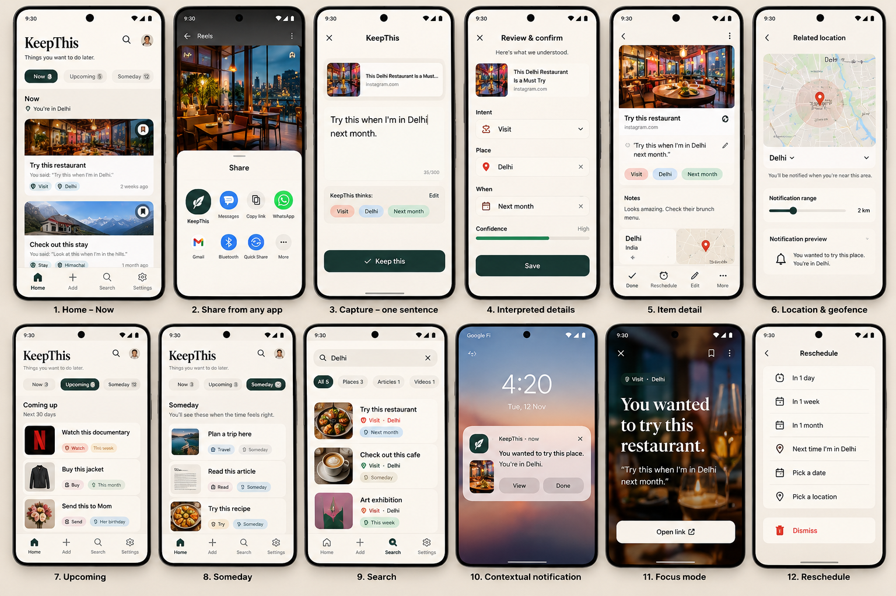

# KeepThis

> **Don't just keep the thing. Keep the reason you kept it.**

An Android intention inbox. Share something, say why in one sentence, and forget about it. KeepThis brings it back at the right time or place. Local-first, with on-device language understanding.


---

## The idea

Most saved content dies in a bookmark graveyard. Instagram saves, browser bookmarks, and read-later lists remember the *thing* but not the *reason*, and they almost never bring it back.

KeepThis captures the intention behind a save:

- "Try this when I'm in Delhi."
- "Buy this next month."
- "Watch this when I have some time."
- "Send this to Mom when I get home."

It turns that one sentence into a structured, time- and context-aware item, then resurfaces it when the condition is met:

> **You wanted to try this place. You're in Delhi today.**

The defining experience:

> **Capture now → forget about it → KeepThis brings it back when it matters.**

## Look and feel



*High-fidelity mockups showing the intended look and flow. They are directional, not final specs. See [docs/overview.md](docs/overview.md) for what to take from each screen and what has been adjusted.*

## How it works

```
Any app → Share → KeepThis
   → add one sentence (optional)
   → Interpreter: dates, places, people, intent, conditions
   → Resolver: merges with device context ("here", "home"), scores confidence
   → Saved locally, unknowns allowed
   → Scheduler: time-based + location-based resurfacing
   → Contextual notification → Done / Later / Reschedule / Forget
```

**Principles**

- **Frictionless capture.** Share sheet first. No folders, tags, or forms.
- **Natural language over forms.** Write a sentence; KeepThis does the structuring.
- **Preserve uncertainty.** If it isn't sure, it asks ("Did you mean Delhi?") instead of guessing.
- **Not an archive.** Items must resurface and be resolved. The goal is acting, not accumulating.
- **Sparse, meaningful notifications.** They say why, not just what.
- **Local-first.** Your saves, notes, and interpretations stay on your device.

## V1 scope

**In**

- Android share sheet capture (URL or text) with an optional one-sentence note
- On-device interpretation: intent, dates and times, places, people, conditions
- Confidence scoring and inline "ask, don't guess" confirmation
- Metadata enrichment of shared links (title, preview, page type)
- Time-based and location-based resurfacing
- Home sections, item detail, search, reschedule, history
- Manual reminders by typing or voice (secondary feature)

**Deliberately out**

Accounts, cloud sync, social features, subscriptions, collaborative lists, continuous background location tracking, AI chat, folders and tags, calendar integration.

**Later**

Gemini Nano (Tier 3) for ambiguous sentences, calendar-aware conditions, semantic search with on-device embeddings, widgets and a Quick Settings tile.

## Language understanding (Tier 2)

The V1 interpreter runs on-device and combines:

- **ML Kit Entity Extraction** for dates, times, and addresses
- **A small sentence-embedding model** matched against seed phrases for intent (Buy, Visit, Watch, Read, Try, Send, Call, Do, Remember)
- **NER plus a place gazetteer** for places and people
- **A deterministic condition grammar** for phrases like "when I'm in Delhi" or "when I get home"
- **Device context** to resolve words like "here" and "home"

ML layers produce predictions and entities. Deterministic application code builds the final item. An optional Gemini Nano escalation layer is planned for a later version, behind a clean interface.

## Privacy

KeepThis is **local-first**, not "fully offline". Be precise about what leaves the device:

| Stays on device | May use the network |
|---|---|
| Saved URLs, notes, entities, interpretations, location context, history | One-time ML Kit model download |
| | Geocoding of place names |
| | Fetching page metadata for links you share |
| | Speech-to-text, if you use voice input and on-device recognition isn't available |

No accounts, no backend required, no continuous location tracking. Permissions are requested in context, and location is optional.

## Tech stack

- **Platform:** Android
- **App ID:** `in.moops.keepthis`
- **UI:** Flutter
- **Native Android (Kotlin):** share intent, location and geofencing, notifications, WorkManager, ML Kit integration
- **Storage:** local database (SQLite)
- **Architecture:** layered, with a domain layer that doesn't depend on Android APIs, so the interpreter is unit-testable

Details and tradeoffs are in [docs/overview.md](docs/overview.md).

## Getting started

Prerequisites: [Flutter SDK](https://docs.flutter.dev/get-started/install), Android Studio (or the Android SDK), and an Android device or emulator.

```bash
git clone https://github.com/moopsIN/KeepThis.git
cd KeepThis
flutter pub get
flutter run
```

Location resurfacing is best tested on a real device, since emulators handle geofencing and battery behavior differently.

## Project status

Early. The plan is to prove the hardest part first: share a link, write "try this when I'm in Delhi", and get a geofenced notification. Everything else builds on that.

Milestones, risks, and open questions are tracked in [docs/overview.md](docs/overview.md).

## Documentation

- [Project overview](docs/overview.md): product, principles, scope, architecture, data model, resurfacing, evaluation plan, mockup notes, build order, risks
- [Mockups](docs/mockup/mock-1.png)

## Evaluation and honesty

This is a technology and interaction-design portfolio project. The interpreter will be measured against a labeled sentence set, and known failure cases (such as unreliable Instagram metadata and city-level geofencing quirks) will be documented here as they are found.

## License

[MIT](LICENSE)
